# Technical Spec: coding-eval-harvest — coding-agent datapoints from merged fixes

> **Language:** This document uses ASD-STE100 Simplified Technical English. Command names, file
> names, field names, function names, and product names are technical names. Customer quotes are
> verbatim.

**PRD:** [prd.md](./prd.md)
**Builds on:** [pr-eval-harvest tech plan](../pr-eval-harvest/tech-plan.md) and
[gitlab-forge tech plan](../gitlab-forge/tech-plan.md). The layering (pr-eval-harvest ADR-4), the
`GitCommandRunner` chokepoint, the refusal shape, and the exit codes do not change.
**North Star:** An SDE who owns a repository points a coding agent at this CLI. The SDE gets Harbor
coding-eval datapoints from the merged fixes of their own repository. The history of the repository
does not fill the context of the agent.
**Author:** eval-harvest team
**Status:** Draft

---

## 1. Context from the PRD

- **North star:** An SDE who owns a repository points a coding agent at this CLI and gets Harbor
  coding-eval datapoints from the merged fixes of their own repository. The history of the
  repository does not fill the context of the agent. The SDE uses the datapoints to validate and
  tune the coding agent before they trust it with real work.
- **Primary customer:** The SDE who is responsible for a repository, with no data science
  background. This is the same customer as pr-eval-harvest.
- **Problem:** A coding agent can make a coding datapoint from a good candidate. It cannot find
  candidates at scale, because the merged history fills its context. Today the customer gets 2
  datapoints. The customer needs `[TODO: set — e.g. 20]` to compare or tune agents.
- **User stories in scope:**

  | Story | Title | Acceptance criteria (summary) |
  |-------|-------|------------------------------|
  | US-1 | Learn the coding-datapoint method from the CLI | Help and man pages teach the task shape and the difference from PR-review datapoints. An agent with only the help makes a datapoint that passes US-6. |
  | US-2 | Survey candidates without reading history | Facts for each candidate without a diff. Ranks and exclusions have reasons. Pages have a size limit and the agent can continue a survey. The output is deterministic. |
  | US-3 | Capture the material of one candidate | One bundle: base, fix split into source and tests, PR and issue text, the tests of the PR. Refuse an unrecoverable base or fix. |
  | US-4 | Record the judgment of the agent with its evidence | Instruction, hidden tests (fail-to-pass or pass-to-pass, with evidence), validation spec, rubric. No judgment by the CLI. |
  | US-5 | A base that builds and stays built | Refuse a base that does not build or whose suite fails. Sealed environment. |
  | US-6 | Verify that the datapoint tests the correct thing | Fail-to-pass and pass-to-pass proof. Leakage scan with a canary. Uniform instruction. Oracle only in `solution/`, reference patch only in `tests/`. Actionable failures. |
  | US-7 | One dataset for the two datapoint types | Counts and refusal reasons for each type. A repository without coding datapoints gets a refusal that the SDE can use. |

- **Out of scope:** Design-and-Build tasks. Guided variants. One task from a group of PRs. Repeated
  oracle/no-op trials and reward-hacking analysis. Eval runs, scores, and ranks. An LLM in the CLI.
  Synthetic bugs. **New in this plan:** the runner that builds environments and runs the hidden
  tests (ADR-2). The implementation must not add these items again.
- **Open PRD questions still unresolved:** All are carried here verbatim:
  - `[TODO: measure — N candidates or N commits read]`
  - `[TODO: set — e.g. 20]`
  - `[TODO: count requests — N asks over the last N months]`
  - `[TODO: measure the yield on 1–2 real repositories — merged PRs → candidates with a usable fail-to-pass test]`
  - `[TODO: measure the build success rate across a real candidate set]`
  - `[TODO: measure — time per hand-built datapoint, context resets per datapoint]`
  - `[TODO: set — straw man ≥20 in one session, no context reset]`
  - `[TODO: set — straw man 80% / 100%, the inherited kill criterion]`
  - `[TODO: measure and set a bound]` (agent context for each surveyed candidate)
  - `[TODO: N]` (calibration sample, and the v1 "sufficient" target)
  - The PRD lists two assumptions that are not validated: most context cost is in the screen step,
    and agent-written instructions do not leak and do not give too little information.

## 2. Requirements

### 2.1 Functional Requirements

The FR/NFR/TP ids are planning aids for this spec only. They are not a shipped requirement graph
(CLAUDE.md).

| Req ID | User Story | Requirement | Acceptance Criteria |
|--------|-----------|-------------|--------------------|
| FR-1 | US-1 | `--help` for `survey`, `capture`, `brief`, `show`, `annotate`, `emit`, `verify`, and `dataset` teaches the coding method when `--type coding` or `--kind fix` applies. A new man page `man/eval-harvest-coding.md` gives the full task shape. | `tests/integration/test_help_methodology.py` finds a sentence for each item: instruction style, base commit, oracle fix, fail-to-pass, pass-to-pass, validation spec, task rubric, taste judge, patch bloat, and each "worthless datapoint" property. |
| FR-2 | US-1 | The top-level help and the coding man page tell the difference between a coding datapoint and a PR-review datapoint. | The help text contains a table of the two types: what the agent under test receives, what it must produce, and what scores it. A test pins the table rows. |
| FR-3 | US-1 | The help requires behavioral hidden tests through public interfaces. It prohibits tests that pin implementation details of the oracle. | A phrase-contract test pins the sentence. |
| FR-4 | US-1 | The eval harness (`eval/`) gets one coding objective. An agent that has only the help output builds a coding datapoint. | `eval/objectives/<repo>-fix.toml` loads through `eval/catalog.py`. The result counts as a kill-criterion run. |
| FR-5 | US-2 | `survey --type coding` reports, for each merged PR: `linked_issues`, `source_paths`, `test_paths`, `source_lines_added`, `source_lines_deleted`, `files_touched`, and `author_commits`. It reads no diff text into the output. | A fixture repository gives the expected values for each field. |
| FR-6 | US-2 | `survey --type coding` excludes a PR for a fixed set of reasons: `not-merged`, `no-integration-commit`, `no-source-change`, `no-test-change`, `bot-author`, `source-too-small`, `source-too-large`, `too-many-files`. Each excluded PR carries all its reasons. | A fixture with one PR for each reason gives that reason and no other. |
| FR-7 | US-2 | `survey --type coding` ranks the PRs that it does not exclude, with a fixed sort key: linked issue, fix signal, author commits, PR number. Each ranked PR carries its `rank_reasons`. | A fixture with PRs that are different in one key at a time gives the expected order. |
| FR-8 | US-2 | `survey --type coding` writes the full result to `<dataset>/survey/fix-survey.json` and prints one page. `--page <n>` prints page *n* from that file. It makes no forge call and no git call. | A page request with `gh` and `git` stubbed to fail succeeds. |
| FR-9 | US-2 | Each page has a size limit: at most `--page-size` rows (default 20, maximum 50), titles cut to 80 characters, and one `next:` command line. | A fixture with 500 PRs gives pages that are all below the NFR-3 byte limit. |
| FR-10 | US-2 | Two surveys of the same clone and the same forge payload give byte-identical `fix-survey.json` files and pages. | A golden-file test. |
| FR-11 | US-7 | When `survey --type coding` excludes all PRs, it refuses `no-harvestable-fix` (exit 3). The `offending` field names the most frequent reason in words that the SDE can use. | A fixture where all PRs have `no-test-change` gives: "fixes in this repository ship without tests that fail before the fix". |
| FR-12 | US-3 | `capture <pr> --type coding` writes `candidates/fix-<n>.json` and two patch files: `patches/fix-<n>/source.patch` and `patches/fix-<n>/tests.patch`. The base is the first parent of the integration commit. | The two patches together are equal to `git diff <base> <merge>`. Each changed path is in one patch only. |
| FR-13 | US-3 | The candidate contains the PR title and body, and the title and body of each linked issue. Each body has a limit of 4000 characters, with a `truncated` flag. | A fixture issue with 10 000 characters gives 4000 characters and `truncated = true`. |
| FR-14 | US-3 | `capture --type coding` refuses `fix-base-unrecoverable` when the merge commit or its first parent is not in the clone. It refuses `no-source-change` when the source patch is empty. Each refusal tells why and gives the next command. | Two fixtures, one for each refusal. |
| FR-15 | US-3 | `brief fix-<n>.json` prints the bundle without patch bytes. `show fix-<n>.json --path <file>` prints the hunks of the fix for one file. | `brief` output contains no `@@` hunk header. `show` output contains only the hunks of the given path. |
| FR-16 | US-4 | The candidate has judgment slots: `instruction`, `instruction_rationale`, `tooling_note`, `hidden_tests`, `rubric_criteria`, and `environment`. `capture` leaves all of them empty. | After `capture`, every judgment slot is empty and `FixCandidate.validate_filled` lists each one. |
| FR-17 | US-4 | Each `hidden_tests` entry has `repo_path`, `name`, `kind` (`fail_to_pass` or `pass_to_pass`), `origin` (`pr` or `agent`), and `evidence`. The test file is in `candidates/fix-<n>/hidden/<repo_path>`. | `emit` refuses an entry with no evidence, an unknown `kind`, or a missing file. |
| FR-18 | US-4 | `annotate` merges records for the coding slots. It does not infer a value. | A record for each slot merges. A record for an unknown slot is refused. |
| FR-19 | US-4 | The CLI makes no judgment. The package has no model client. | `tests/unit/test_no_model_client.py` stays green with the new modules. |
| FR-20 | US-5 | `emit --kind fix` writes `environment/Dockerfile`. The Dockerfile seals the clone at the base and then runs the `environment.setup_steps` of the agent. | The Dockerfile contains the six sealing steps of FR-30 (pr-eval-harvest) in sequence, then one `RUN` line for each setup step. |
| FR-21 | US-5 | `emit` refuses `environment-recipe-invalid` for a setup step that contains a line break or a trailing backslash, for a base image that is not in `public.ecr.aws/`, and for a missing lockfile. | One test for each condition. |
| FR-22 | US-5 | The candidate records `merge_date` as a fact. The coding help tells the agent to pin the dependencies to this date. | The help contains the Python example `uv pip compile --exclude-newer <merge_date>`. |
| FR-23 | US-5, US-6 | `verify` has the check `hidden-tests-proven`. This check covers the base build, the existing suite at the base, the fail-to-pass rule, and the pass-to-pass rule. When no valid proof file exists (FR-35), `verify` reports the check as unresolved (exit 5). | `verify` on a correct coding datapoint with no proof file exits 5 and names `hidden-tests-proven`. |
| FR-35 | US-5, US-6 | `verify` reads `<dataset>/proofs/<task-dir>.json` when it exists. A runner outside the CLI writes this file. `verify` resolves `hidden-tests-proven` from it: pass when the proof obeys the rules below, failure when it does not, and unresolved when the `content_digest` in the proof is not the digest of the task. The rules: in the nop trial, each fail-to-pass test fails, and each pass-to-pass test and the existing suite pass. In the oracle trial, all tests pass. A trial with a build error is a failure named `base-does-not-build`, with the failed step. | One test for each condition: a valid proof passes; a fail-to-pass test that passes at nop fails, and the refusal names the test; a build error fails `base-does-not-build`; a digest that is different gives unresolved. |
| FR-24 | US-6 | `verify` runs `base-and-patch` on `solution/oracle.patch`. | A datapoint with an oracle patch that does not apply fails `patch-does-not-apply`. |
| FR-25 | US-6 | The content scan of `verify` adds these tokens for a coding datapoint: `#<issue>` for each issue, the PR and issue URLs, the merge commit SHA (full and the first 12 characters), and each hidden test name. The scan also uses the existing long-line fragments from `solution/` and `tests/`. | A planted leak of each token type fails `answer-present`. |
| FR-26 | US-6 | A new check `instruction-names-fix` scans only `instruction.md`. It looks for each path that the oracle patch changes, and for each symbol that the patch defines or changes. It does not use the base-tree suppression. It uses its own control token. | An instruction that names a changed path fails. An instruction with no names passes. A scan with no control token fails `scan-did-not-run`. |
| FR-27 | US-6 | A new check `instruction-uniform` removes the two declared slots from `instruction.md` and compares the remainder to the canonical template bytes. | A changed word in the general instructions fails. |
| FR-28 | US-6 | A new check `answer-placement` makes sure that `oracle.patch` is only in `solution/`, that `reference.patch` and the hidden tests are only in `tests/`, and that no file in `environment/` has the same bytes as one of them. | A copy of `oracle.patch` in `environment/` fails. |
| FR-29 | US-6 | A new check `spec-coherent` makes sure that `tests/validate/validation_spec.toml` has at least one story with at least one case, that `tests/judge/rubric.toml` has at least one `fail_to_pass` criterion, and that `tests/verify/tests.toml` lists at least one `fail_to_pass` test with an existing file. | One test for each missing item. |
| FR-30 | US-6 | Each coding failure uses the four-field refusal shape (`check`, `datapoint`, `offending`, `next`). | Every new check has a `next` that names a command or a file to change. |
| FR-31 | US-6 | `emit --kind fix` assembles the task, runs `verify`, and promotes the task only when no check fails. An unresolved check does not stop the promotion. | The existing `_assemble_verify_promote` behavior applies to coding datapoints. |
| FR-32 | US-7 | `dataset` reads `[metadata.harvest].datapoint_type`. A task without this field is `review`. The report gives a count for each type, and a count of coding datapoints with `hidden-tests-proven` unresolved. | A dataset with 2 review tasks and 3 coding tasks reports `review: 2, coding: 3, coding_unproven: 3`. |
| FR-33 | US-7 | `capture`, `emit`, and `survey` write each refusal to `<dataset>/refusals/<type>/<datapoint>.json` when the verb has a dataset. `dataset` reports the refusal reasons for each type. | After one coding refusal and one review refusal, the report lists one reason under each type. |
| FR-34 | US-7 | `dataset.toml` contains both types. `registry.json` is a JSON list with one entry for each type that has tasks (`<name>-review`, `<name>-coding`) and one entry for all tasks (`<name>`). The report gives one `harbor run` command for each type. The dataset `metric.py` calculates the mean of each reward key over the tasks of its own type only. | Harbor 0.22.0 `Registry.from_path` loads the file and lists all entries. A metric test with mixed rewards gives the per-type mean. |

### 2.2 Non-Functional Requirements

| Req ID | Category | Requirement | How Measured | Driver |
|--------|----------|-------------|-------------|--------|
| NFR-1 | Determinism | The same clone and the same forge payload give byte-identical survey files, candidates, patches, and task directories, with the same `content_digest`. | Golden-file tests and a two-emit comparison test. | US-2, inherited NFR-1 |
| NFR-2 | Offline | `emit`, `verify`, `dataset`, `brief`, `show`, `annotate`, and `survey --page` make no forge call and no `git fetch`. | The existing offline test with `gh`, `glab`, and `git remote` stubbed to fail, extended to the coding verbs. | inherited NFR-2 |
| NFR-3 | Context budget | One survey page with 20 rows is at most 8 KiB in the human form and at most 18 KiB with `--json`. A `brief` for one candidate is at most 12 KiB. Targets from G-1 (`measurements.md`): the largest measured pages are 5 500 and 14 003 bytes, the largest brief 8 611 bytes. | A test counts the bytes on a 500-PR fixture. | US-2 north star, PRD §8 |
| NFR-4 | Forge cost | `survey --type coding` makes the same forge calls as `survey` (one paged `gh pr list` or `glab` query). `capture --type coding` makes one PR call plus one call for each linked issue. | A counting stub in the integration tests. | US-2, inherited NFR-7 |
| NFR-5 | Scale | `survey --type coding` on 1000 merged PRs completes in at most 174 s (two times the 87 s median of `mise run bench-fix-survey` on an Apple M2 Pro, G-1). The git calls for each PR have a fixed maximum of 6 (the benchmark measures 3). | A benchmark on a generated fixture. A counting test for git calls. | US-2 |
| NFR-6 | Dependencies | `[project].dependencies` stays empty. | The existing dependency audit test. | inherited NFR-5 |
| NFR-7 | Security | Untrusted text (PR bodies, issue bodies, setup steps) never goes to a shell of the CLI. The CLI never runs a setup step. Setup steps go only into Dockerfile `RUN` lines, with the FR-21 limits. | The argv-only rule in `gitcmd.py`. A test that a setup step with a line break is refused. | inherited §3 constraint |
| NFR-8 | Honesty | A coding datapoint never reports `hidden-tests-proven` as passed in this feature. Every scan proves that it ran with a control token. | The FR-23 test. Guard tests in `tests/integration/test_guards.py`. | CLAUDE.md conventions |
| NFR-9 | Compatibility | Every existing PR-review test passes without change, except the test doubles that mirror a changed signature. | `mise run check`. | US-7 |
| NFR-10 | Portability | The coding verbs behave the same on macOS and Windows. | The existing CI matrix. | inherited NFR-4 |

**Categories that do not apply:** *Privacy:* the feature reads the same repository data as
pr-eval-harvest and adds issue text only. No new data class. *Cost:* the CLI uses no paid service.
The reward stack in each task calls Bedrock at eval time, and the customer pays for it (as in
notebook 03). *Operability:* the CLI is a local tool with no service to operate.

### 2.3 Technical Prerequisites

| Req ID | Prerequisite | Why it's required |
|--------|-------------|------------------|
| TP-1 | `Survey.mainline` (`survey.py:295`) records the author email of each commit. | FR-5 needs `author_commits`. Without the email, each PR needs one more git call, and NFR-5 fails. |
| TP-2 | One function that splits a unified diff into a source patch and a test patch with `TEST_MARKERS` (`survey.py:78`). | FR-5, FR-6, and FR-12 must agree on which path is a test. Two copies of the rule can disagree. |
| TP-3 | `Harbor._check_artifacts` (`harbor.py:439`) accepts the `exclude` field of an artifact. `HarvestFields` gets a coding variant. | FR-20 and ADR-4 need the artifact `{source = "/work/repo", exclude = [".git"]}`. Harbor 0.22.0 has `exclude` in `ArtifactConfig` (`harbor/models/task/config.py:639`). |
| TP-4 | `Dataset._read_one_task_record` (`dataset.py:172`) reads `datapoint_type` and does not require change-risk fields for coding tasks. | Today it refuses `malformed-task` for any task without `change_risk_*`. Every coding task would fail. |
| TP-5 | A refusal record writer, shared by `capture`, `emit`, and `survey`. | FR-33 needs persistent refusals. Today refusals go only to stderr and to the batch report. |
| TP-6 | `Forge.fetch_issue` and `GitLab.fetch_issue`. | FR-13 needs the issue text. Neither forge module reads an issue today. |
| TP-7 | Remove `no-test-change` from the review blockers in `Survey._blockers` (`survey.py:398`). Keep `has_test_change` as a fact in the row. Do this as a separate commit, before this feature. | This is an existing defect. The remedy text of the blocker (`survey.py:54`) says that such a PR is "harvestable for review", but `Survey._harvestable` (`survey.py:568`) removes each PR with a blocker. A review datapoint does not need tests. No PRD or tech plan asks for this blocker. It came in with commit `572a3c9`. The coding survey must own this exclusion alone, or the two survey types disagree. |
| TP-8 | `Dataset._write_registry` (`dataset.py:287`) writes `registry.json` as a JSON list of entries. | This is an existing defect. Today the file is one JSON object. Harbor 0.22.0 `Registry.from_path` (`harbor/models/registry.py:102`) reads a list, and it refuses an object with a `ValidationError`. We ran this probe: one object fails, and a list with two entries loads. Thus `harbor run --registry-path` cannot use the current file. FR-34 also needs a list. |

## 3. Constraints

- **Codebase patterns:**
  - Each file has one class with class methods and static methods, and no state (`CODING_STANDARDS.md` §1).
  - Structured data uses `TypedDict` and frozen dataclasses on the CLI path, not Pydantic. The
    runtime has no dependencies (pr-eval-harvest ADR-2; `candidate.py:41`). This is an existing
    deviation from `CODING_STANDARDS.md` §5. The coding modules follow the existing code.
  - Every `git`, `gh`, and `glab` call goes through `GitCommandRunner` (`gitcmd.py:29`).
  - Each refusal has the four fields and an exit code from `cli.ExitCode` (`cli.py:242`): 0
    success, 2 usage, 3 refusal, 4 verification failure, 5 unresolved.
  - The filesystem is the bus between verbs (pr-eval-harvest tech plan §6.2).
- **Infrastructure:**
  - `harvest_env` rejects `no-network` and allowlist policies (`harvest_env/README.md`;
    `lambda_microvms.py:235`). All emitted tasks use `no-network` for the agent. Thus no emitted
    task can run on Lambda MicroVMs today. The customer runs the coding tasks with the default
    Harbor Docker environment until this changes.
  - The CLI never imports `harvest_env` or `eval/` (CLAUDE.md).
- **Compatibility:**
  - The PR-review candidate schema, the `survey --json` payload, and the emitted review task are
    pinned (pr-eval-harvest decisions-tech-plan, contract entries). This feature must not change
    them.
  - `Harbor.validate_task_config` refuses `shared` verifier mode (`harbor.py:336`). The coding
    task uses `separate` mode (ADR-4).
  - Harbor reads only `[metadata.*]` and a top-level `source` from unknown keys. Coding provenance
    goes under `[metadata.origin]` and `[metadata.harvest]`.
  - Harbor's `aggregate_reward_dicts` (`harbor/metrics/base.py:14`) uses the union of the reward
    keys and gives 0 to a missing key. In a mixed dataset, the mean of a key also counts the tasks
    of the other type as 0 (ADR-5).
- **Performance:** NFR-3 and NFR-5. The survey must keep one `git log --first-parent` pass for the
  full mainline (`survey.py:295`), not one call for each PR.
- **Security:**
  - Untrusted repository text never goes to a shell (`gitcmd.py` module docstring).
  - The CLI never runs the code of the repository (ADR-2).
  - Base images come from ECR Public only, as in `emit.py:80`.
  - Setup steps are single lines (FR-21). Without this rule, one line break can add a Dockerfile
    instruction.

## 4. Risks & Mitigations

| Risk | Likelihood | Impact | Mitigation | Early warning sign |
|------|-----------|--------|------------|-------------------|
| **Low yield:** few merged fixes include tests that fail before the fix | Med | High | FR-11 refusal with the most frequent reason. Measure the yield on 1–2 real repositories before the D and E workstreams finish (PRD §9). | The first real survey excludes more than 70% of PRs for `no-test-change` (G-1 measured 30% and 59%). |
| **Unproven datapoints in the dataset:** until a runner exists, a coding datapoint with a wrong fail-to-pass test passes `emit` | High | High | `hidden-tests-proven` is unresolved without a proof file (FR-23). The proof-file contract (FR-35) lets a separate runner resolve the check with no format change. `dataset` counts unproven coding datapoints (FR-32). | A dataset report with `coding_unproven` equal to `coding` while the customer runs `harbor run`. |
| **A proof from an old task passes a changed task** | Med | High | The proof records the `content_digest`. A different digest gives unresolved, not pass (FR-35). | A proof file older than the task directory. |
| **Old bases do not build** | Med | High | The agent pins dependencies to `merge_date` (FR-22). The future runner gives the failing step. | The first oracle trials in Harbor fail at image build. |
| **Reward hacking through the agent tree:** the agent adds a `conftest.py`, a `sitecustomize.py`, or a test plugin outside the test directories | Med | High | Separate verifier mode (ADR-4). The verifier restores every base test path and adds the hidden tests to a pristine copy of the base. Notebook 03 used the same restore step. | An oracle-free trial scores `fix_correct = 1`. |
| **Mixed-dataset means are wrong:** Harbor gives 0 to a missing key | High | Med | `registry.json` has one entry for each type (FR-34). The report gives one `harbor run` command for each type, and these runs give correct means. Namespaced keys (`fix_*`) and a per-type `metric.py` also apply (ADR-5). | The SDE runs the combined entry and reads `fix_reward` below the per-type value. |
| **Agent-written tests pin oracle details** | Med | Med | FR-3 help text. The validation agent and rubric judge in the reward stack test behavior. No mechanical check exists (PRD §9). Accepted. | The customer sees a correct alternative fix fail in Harbor. |
| **Instruction gives too little information** | Med | Med | None in the CLI. The customer's oracle runs find it. Guided variants are deferred. Accepted. | Oracle-like agents fail the task in Harbor. |
| **The leakage scan for symbols gives false positives** (a common word such as `get` is a changed symbol) | Med | Low | Only symbols with 4 or more characters, and symbols from definition lines and hunk headers. The refusal names the token, and the agent can use `--override instruction-names-fix` with a record in `task.toml`. | Many `instruction-names-fix` refusals that name common words. |
| **The artifact `/work/repo` is large** | Low | Med | `exclude = [".git"]`. Harbor's Docker environment has no size limit for this path `[TODO: verify]`. `harvest_env` refuses downloads above 512 MiB, but it cannot run these tasks today. | A trial error during the artifact download. |
| **The notebook 03 reward stack is specific to Python and pytest** | High | Med | The port reads the test command from the recipe and requires JUnit XML at `$JUNIT_PATH` (ADR-5). | A non-Python fixture task writes no `junit.xml`. |
| **`gh` or `glab` does not give linked issues in the expected field** | Med | Low | Survey uses `issue_candidates` from the text (`survey.py:542`) as the fallback. `[TODO: verify the gh pr list --json closingIssuesReferences field and the GitLab GraphQL closing-issues field]`. | `linked_issues` is empty for PRs with "Fixes #n" in the body. |
| **Operational risk (3 a.m.)** | Low | Low | The CLI is local and has no service. A failure is a refusal with a `next` command. | — |

**Risks that we accept without mitigation:** Agent-written tests that pin implementation details,
and instructions with too little information. The PRD accepts both (§9). Only eval runs find them,
and the customer does the eval runs.

## 5. Proposed Solution

The feature adds a second datapoint type, `coding`, to the same verbs. The agent selects it with
`--type coding` on `survey`, `capture`, and `brief`, and with `--kind fix` on `emit`. `verify` and
`dataset` read the type from `task.toml`. The PR-review path does not change.

**Survey (FR-5 to FR-11).** `survey --type coding` reads the same forge PR list as the review
survey, through `Survey.fetch_pull_requests` or `GitLab.fetch_merge_requests`. It reads the full
mainline in one `git log --first-parent` pass, and the pass now records the author email (TP-1).
For each merged PR, the new `FixSurvey` class uses the existing integration-commit facts
(`Survey._range_facts`). It adds a `git diff --numstat` of the first parent against the integration
commit. The TP-2 splitter divides the changed paths into source and tests. `FixSurvey` then applies
the exclusion rules and sorts the remaining PRs by a fixed key. It writes the full, deterministic
result to `<dataset>/survey/fix-survey.json` and prints the first page. The agent asks for the next
page with `--page`. A page request reads only the file. Thus the agent reads a bounded page of facts
and reasons, and it never reads history. When the survey excludes all PRs, it refuses
`no-harvestable-fix` with the most frequent reason in plain words.

**Capture (FR-12 to FR-15).** `capture <pr> --type coding` reads the PR and each linked issue from
the forge (TP-6). It uses the local clone to find the merge commit and its first parent, which is
the base. It writes the diff from the base to the merge commit as two patch files: source and tests.
It writes `candidates/fix-<n>.json` with all facts filled and all judgment slots empty. `brief` and
`show` give the agent compact views of this bundle, as they do for review candidates
(pr-eval-harvest ADR-6).

**Judgment (FR-16 to FR-19).** The agent writes the instruction, the tooling note, the hidden test
list, the rubric criteria, and the environment recipe with `annotate`. It writes the hidden test
files, the validation spec, and the lockfile into `candidates/fix-<n>/`. The CLI records each value
with its evidence, and it infers nothing.

**Emit (FR-20 to FR-22, FR-31).** `emit fix-<n>.json --kind fix` uses the new `FixEmit` class. It
validates the candidate and the recipe. It then assembles the task in a temporary directory, with
the same assemble-verify-promote sequence as `Emit._assemble_verify_promote` (`emit.py:543`). The
task has:

- `environment/Dockerfile`: the existing sealing template, then the setup steps of the agent.
- `instruction.md`: the canonical coding template with two slots, `@TASK@` and `@TOOLING@`.
- `solution/`: `oracle.patch` (the source patch) and `solve.sh`, which applies it.
- `tests/`: the verifier image Dockerfile, `test.sh`, the hidden tests and `tests.toml`, the
  validation spec, the judge files with `reference.patch`, and the reward stack from notebook 03.
- `task.toml`: separate verifier mode and the `/work/repo` artifact.

The reward stack runs only in Harbor (ADR-5).

**Verify (FR-23 to FR-30).** `verify` reads the type and keeps all existing checks. For a coding
datapoint it makes these changes:

- `base-and-patch` uses `solution/oracle.patch`.
- The content scan adds the coding tokens.
- `finding-lines-present` and `rubric-coherent` do not apply.
- Four static checks are added: `instruction-names-fix`, `instruction-uniform`, `answer-placement`,
  and `spec-coherent`.
- `hidden-tests-proven` reads the proof file `<dataset>/proofs/<task-dir>.json` (FR-35). A runner
  outside the CLI writes this file after one oracle trial and one nop trial. Without a valid proof
  file, the check is unresolved, because the CLI does not run the code of the repository (ADR-2).

**Dataset (FR-32 to FR-34).** `dataset` reads both types into one manifest. It writes
`registry.json` as a list with one entry for each type and one entry for all tasks (TP-8). It
reports counts, unproven counts, and refusal reasons for each type (TP-4, TP-5). It prints one
`harbor run` command for each type, because only a run on one type gives correct means. It writes a
`metric.py` that calculates per-type means.

**Survey prerequisite (TP-7).** Before this feature, a separate commit removes `no-test-change`
from the review blockers. Then the review survey keeps the PRs that have no test change, and only
the coding survey excludes them.

**Requirements that this solution does not satisfy:** The PRD requires a proof that each
fail-to-pass test fails at the base and passes with the oracle (US-6). The PRD also requires a
refusal of a base that does not build (US-5). This plan specifies the two checks and the proof-file
contract that resolves them (FR-35). It does not supply the runner that writes the proof, because
the customer moved the runner to a separate project (ADR-2). Until that runner exists, the two
criteria stay unresolved. FR-4 (the kill-criterion run) also depends on this runner to show that
the datapoint "passes every US-6 check".

## 6. Architecture

The feature adds modules to the `eval-harvest` package and templates to `verifier_tpl/`. It
changes no boundary. The online layer and the offline layer stay as they are (pr-eval-harvest
§6.1).

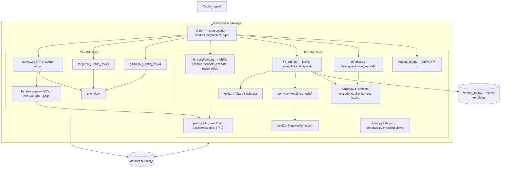

| Module | Status | Responsibility | Layer |
|--------|--------|---------------|-------|
| `src/eval_harvest/fix_survey.py` | New | `FixSurvey`: the facts for each PR, the exclusion rules, the sort key, the cached result, and the pages. | online (the first run), offline (`--page`) |
| `src/eval_harvest/patchsplit.py` | New | `PatchSplit`: one unified diff into a source patch and a test patch, with `TEST_MARKERS`. Also `is_test_path`. | offline |
| `src/eval_harvest/fix_candidate.py` | New | `FixCandidate`: the `FixCandidateDict` schema, `scaffold`, `write_to_dataset`, `validate_facts`, `validate_filled`, and `validate_recipe`. | offline |
| `src/eval_harvest/fix_emit.py` | New | `FixEmit`: plan, assemble, verify, promote. It calls the static helpers of `Emit` for the digest, the files, and the promotion. | offline |
| `src/eval_harvest/refusal_log.py` | New | `RefusalLog`: writes and reads `<dataset>/refusals/<type>/<datapoint>.json`. | offline |
| `src/eval_harvest/verifier_tpl/fix/` | New | `Dockerfile.tmpl`, `verifier.Dockerfile.tmpl`, `test.sh`, `instruction.md`, `solve.sh`, `lib/{aggregate,agent_tests,validate,judges,bedrock}.py`, `judge/models.toml`. These are data. The CLI never imports them. | in-task |
| `src/eval_harvest/survey.py` | Changed | `Commit` gets `author_email`. The `git log` format gets `%ae`. The payload does not change. | online |
| `src/eval_harvest/forge.py`, `gitlab.py` | Changed | `fetch_issue(...)` returns the number, URL, title, and body, or raises `ForgeError`. | online |
| `src/eval_harvest/verify.py` | Changed | Dispatches by `datapoint_type`. Adds the coding checks and tokens. Reads the proof file for `hidden-tests-proven` (FR-35). | offline |
| `src/eval_harvest/seal.py` | Changed | `scan_instruction(task_dir, tokens, control_token)` scans only `instruction.md`. | offline |
| `src/eval_harvest/harbor.py` | Changed | Accepts the artifact `exclude` field. Adds `FixHarvestFields` and an `artifacts` parameter on `task_config_document`. `metric_script` takes the per-type key groups. | offline |
| `src/eval_harvest/dataset.py` | Changed | Per-type records and report. Reads the refusal log and the proof files. Writes `registry.json` as a list with per-type entries (TP-8). | offline |
| `src/eval_harvest/survey.py` (review) | Changed, separate commit | `no-test-change` is no longer a review blocker (TP-7). | online |
| `src/eval_harvest/brief.py`, `show.py`, `annotate.py` | Changed | Coding views and coding slot records, selected by `datapoint_type` in the candidate. | offline |
| `src/eval_harvest/cli.py` | Changed | `--type {review,coding}` (default `review`) on `survey`, `capture`, `brief`. `--kind fix` on `emit`. `--page`, `--page-size`, `--excluded` on `survey`. Coding methodology text. | — |
| `man/eval-harvest-coding.md` | New | The coding method. | docs |
| `eval/objectives/<repo>-fix.toml` | New | The kill-criterion objective (FR-4). | eval |

**The coding task directory:**

```
tasks/<org>__<name>__pr<n>-fix/
  task.toml
  instruction.md                   # canonical template + @TASK@ + @TOOLING@
  environment/Dockerfile           # seal at base, then the agent's setup steps
  environment/<lockfile>
  solution/solve.sh                # git apply /solution/oracle.patch
  solution/oracle.patch            # the source part of the merged fix
  tests/Dockerfile                 # verifier image: pristine base at /work/base + same setup + boto3
  tests/<lockfile>                 # copy of the environment lockfile (tests/ is the build context)
  tests/test.sh
  tests/verify/tests.toml          # test_command, junit_path, protected test markers, F2P/P2P ids
  tests/verify/<hidden test files>
  tests/validate/validation_spec.toml
  tests/judge/{reference.patch, instruction.md, rubric.toml, models.toml}
  tests/lib/{aggregate,agent_tests,validate,judges,bedrock}.py
```

## 7. Sequence Diagrams

### 7.1 Existing flows (as-is)

**Survey (review only today).**

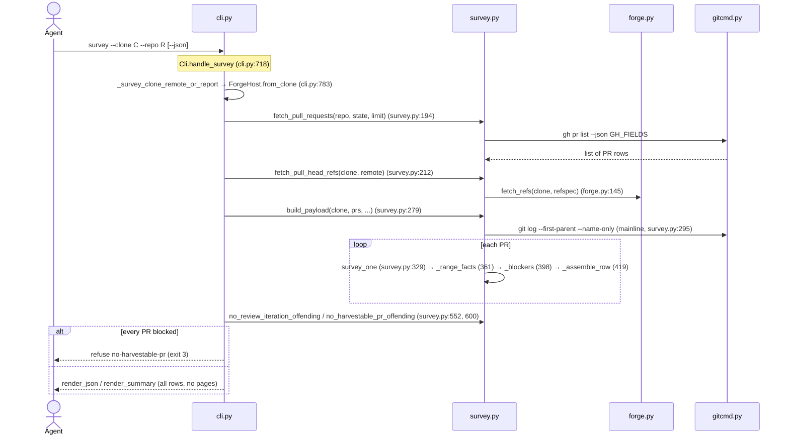

**Capture (review only today).**

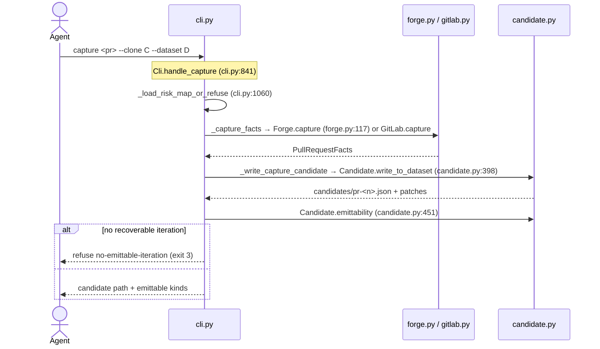

**Emit and verify (review only today).**

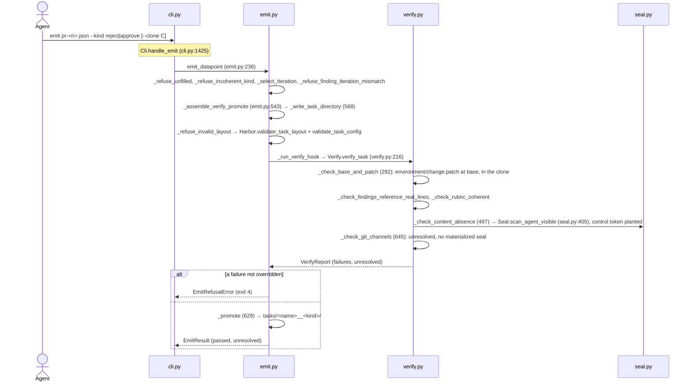

**Dataset (review only today).**

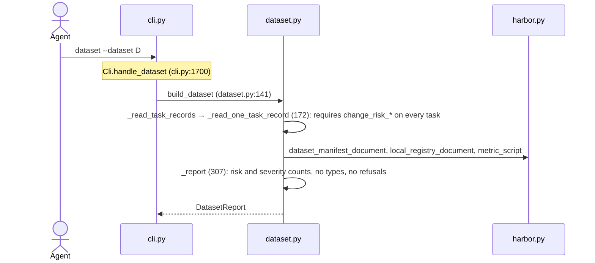

**Where the current flows break down for the north star:**

- The survey prints all rows in one output. It has no pages, no ranks, and no author facts.
  `no-test-change` is a *blocker* for review PRs. The remedy text of this blocker says that such a
  PR is "harvestable for review", but `Survey._harvestable` (`survey.py:568`) excludes every PR with
  a blocker. This discrepancy is in the existing code. The message is correct and the code is
  incorrect, because a review datapoint does not need tests. TP-7 corrects this in a separate commit.
- Capture takes the base from the merge-base of an iteration tip (`forge.py:286`). A coding
  datapoint needs the first parent of the integration commit. Capture reads no issue text.
- Emit and verify know only `environment/change.patch` and review findings. The content scan
  suppresses tokens that exist at the base (`verify.py:459`). This rule hides file paths and symbols
  in the instruction, because these names exist at the base.
- Dataset refuses any task without `change_risk_*`. It records no refusals and no types.
- Dataset writes `registry.json` as one JSON object (`dataset.py:287`). Harbor 0.22.0 reads a list
  (`harbor/models/registry.py:102`) and refuses the object. Thus `harbor run --registry-path` fails
  on the current output. We saw this failure in a probe. TP-8 corrects it.

### 7.2 New or modified flow (to-be)

**Coding survey with pages.** New participants and calls are marked **NEW**.

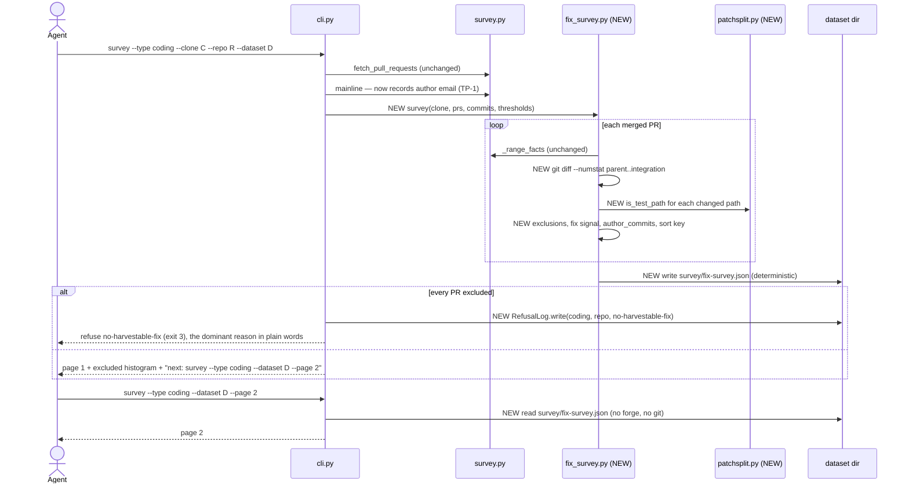

**Coding capture.**

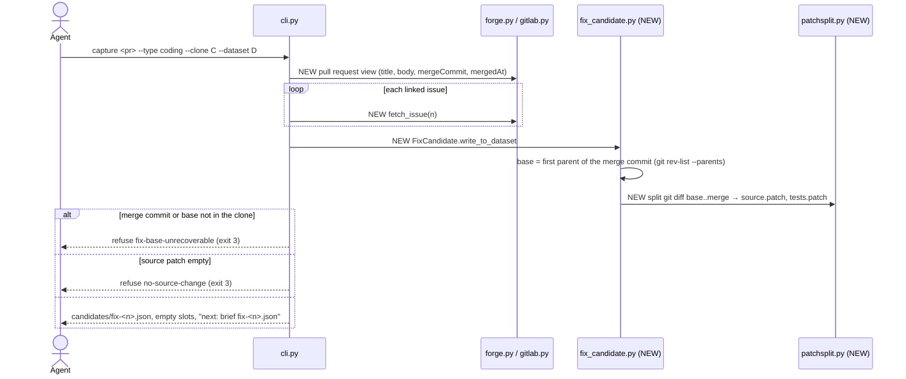

**Coding emit and verify.**

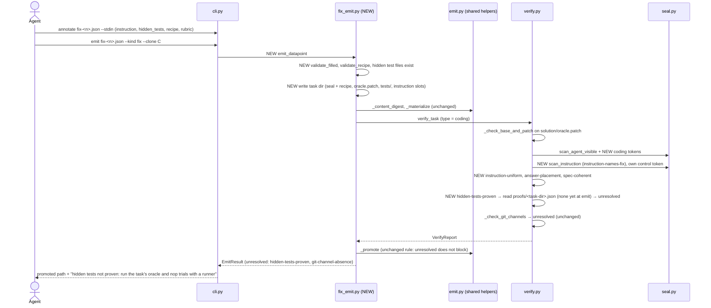

**A separate runner proves the hidden tests (outside this feature).** This diagram shows the
contract only. The runner is not part of this plan.

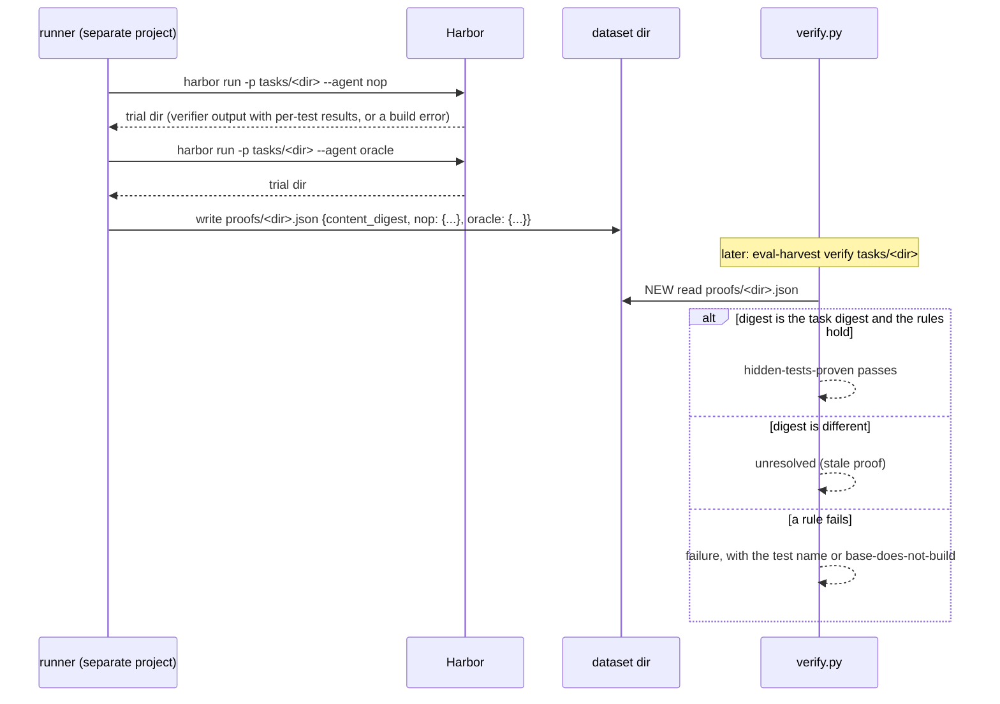

**Coding dataset.**

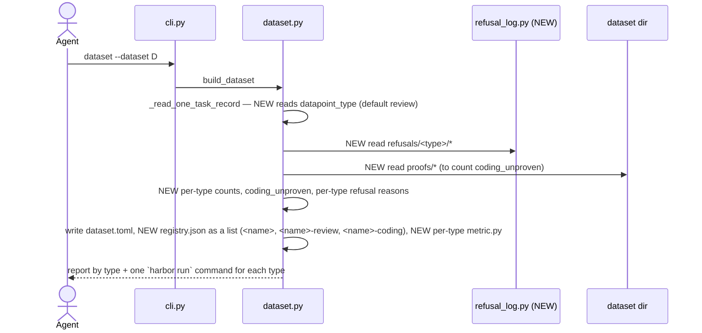

### 7.3 Failure paths

**Emit refuses an instruction that names the fix.**

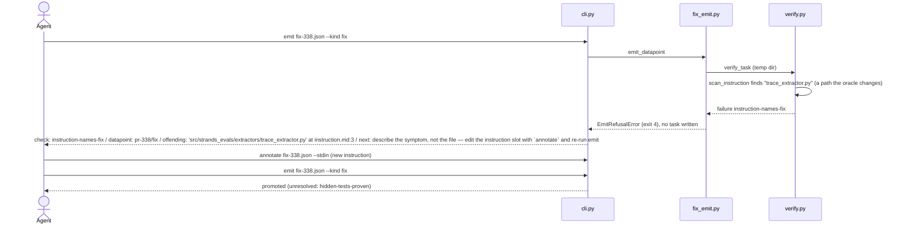

**The forge cannot give the issue during capture.**

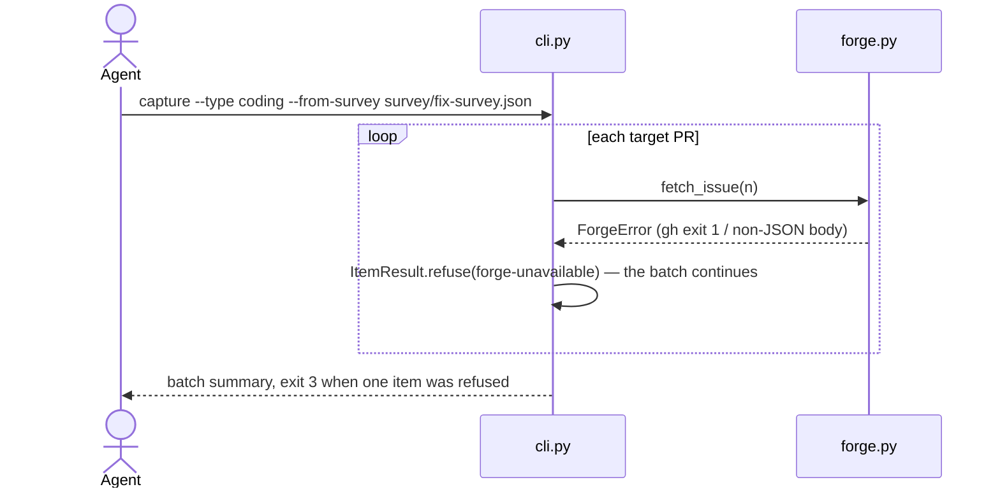

**Verify cannot prove the hidden tests.**

```mermaid
sequenceDiagram
    actor Agent
    participant Cli as cli.py
    participant Verify as verify.py
    Agent->>Cli: verify tasks/...pr338-fix --clone C
    Cli->>Verify: verify_task
    Verify->>Verify: read proofs/<dir>.json → absent, or content_digest is different
    Verify-->>Cli: all static checks pass; hidden-tests-proven unresolved; git-channel-absence unresolved
    Cli-->>Agent: exit 5 — "no valid proof: fail-to-pass and pass-to-pass need an oracle trial and a nop trial; a runner writes proofs/<dir>.json"
```

**The proof shows that a fail-to-pass test passes at the base.**

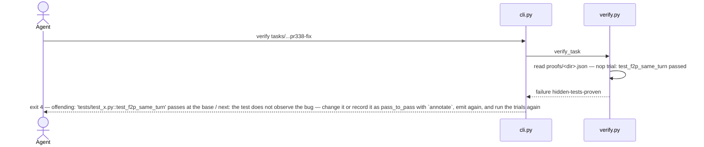

## 8. Data Model

The feature adds files to the dataset directory. It adds no database. All files are written
deterministically.

**`candidates/fix-<n>.json`** (`FixCandidateDict`, a `TypedDict` in `fix_candidate.py`):

| Field | Type | Written by | Notes |
|-------|------|-----------|-------|
| `datapoint_type` | `"coding"` | capture | Selects the coding views and checks. |
| `task_type` | `"investigate-and-fix"` | capture | The seam for Design-and-Build (PRD §10). |
| `repo`, `pr_number`, `pr_url` | str, int, str | capture | Same meaning as in the review candidate. |
| `pr_title`, `pr_body`, `pr_body_truncated` | str, str, bool | capture | Body limit 4000 characters. |
| `issues` | list of `{number, url, title, body, body_truncated}` | capture | Sorted by number. Empty when none is linked. |
| `merge_commit`, `base_commit` | str | capture | `base_commit` is the first parent of `merge_commit`. |
| `merged_at`, `merge_date`, `base_commit_date` | str | capture | `merge_date` is `YYYY-MM-DD` from `merged_at`. |
| `source_patch_path`, `test_patch_path` | str | capture | Relative to the dataset. |
| `source_paths`, `test_paths` | list[str] | capture | Sorted. |
| `source_lines_added`, `source_lines_deleted`, `author_commits` | int | capture | Same values as the survey row. |
| `instruction`, `instruction_rationale` | str | agent | The `@TASK@` slot. |
| `tooling_note` | str | agent | The `@TOOLING@` slot. One line, at most 200 characters. |
| `hidden_tests` | list of `{repo_path, name, kind, origin, evidence}` | agent | Sorted by `(repo_path, name)`. |
| `rubric_criteria` | list of `{id, kind, text}` | agent | `kind` is `fail_to_pass` or `pass_to_pass`. |
| `environment` | `{base_image, setup_steps, lockfile, test_command, rationale}` | agent | `test_command` must write JUnit XML to `$JUNIT_PATH`. |

**Agent-written files:** `candidates/fix-<n>/hidden/<repo_path>`,
`candidates/fix-<n>/validation_spec.toml`, and `candidates/fix-<n>/<lockfile>`.

**`survey/fix-survey.json`:** `{repo, mainline_commits, thresholds, ranked: [row…], excluded:
[row…]}`. A ranked row has `number`, `title`, `url`, `merged_at`, `rank`, `linked_issues`,
`fix_signal`, `source_files`, `source_lines_added`, `source_lines_deleted`, `test_files`,
`files_touched`, `author_commits`, and `rank_reasons`. An excluded row has `number`, `title`, and
`excluded_by`. Both lists are in a fixed sequence (FR-10).

**`proofs/<task-dir>.json`** (written by a runner outside the CLI, read by `verify` and `dataset`):

```json
{
  "content_digest": "sha256:…",
  "runner": "<name and version of the runner>",
  "nop":    {"status": "completed", "build_error": "", "tests": {"tests/test_x.py::test_f2p_a": "failed", "tests/test_x.py::test_p2p_b": "passed"}, "existing_suite": "passed"},
  "oracle": {"status": "completed", "build_error": "", "tests": {"tests/test_x.py::test_f2p_a": "passed", "tests/test_x.py::test_p2p_b": "passed"}, "existing_suite": "passed"}
}
```

`status` is `completed` or `build-failed`. `build_error` names the failed step when `status` is
`build-failed`. Each test id is `<repo_path>::<name>`, the same id as in `tests/verify/tests.toml`.
The CLI never writes this file. A runner writes it after it runs the task in Harbor with the `nop`
agent and with the `oracle` agent. The emitted verifier writes the per-test results to
`/logs/verifier/verifiers.json`, so a runner can copy them from the trial directory.

**`refusals/<type>/<datapoint>.json`:** `{check, datapoint, offending, next, verb}`. A new refusal
for the same datapoint replaces the old one. A datapoint that the CLI later emits successfully has
its refusal file removed. Thus the report shows only current refusals.

**`task.toml` additions for a coding task:**

```toml
[[artifacts]]
source = "/work/repo"
exclude = [".git"]

[metadata.origin]
repo = "strands-agents/evals"
pr_numbers = [338]
issue_numbers = [337]
base_commit = "0bf1252…"
merge_commit = "cc0a391…"
base_commit_date = "2026-07-29"
merged_at = "2026-07-31"

[metadata.harvest]
datapoint_type = "coding"
kind = "fix"
task_type = "investigate-and-fix"
fail_to_pass = 7
pass_to_pass = 6
overrides = []
content_digest = "sha256:…"
```

**`registry.json`** becomes a JSON list (TP-8). Each entry has the existing shape from
`Harbor.local_registry_document` (`harbor.py:842`): `name`, `version`, `description`, `tasks`. The
entries are `<name>` (all tasks), `<name>-review` (only when review tasks exist), and
`<name>-coding` (only when coding tasks exist). The sequence is fixed (NFR-1).

**Migration:** None for the stored data. Existing candidates and tasks have no `datapoint_type`.
Each reader treats a missing value as `review`. No backfill is necessary. An existing
`registry.json` is an object, and Harbor cannot read it. The next `dataset` run replaces it with a
list. **Rollback:** Remove the coding files (`candidates/fix-*`, `tasks/*-fix`, `survey/`,
`proofs/`, `refusals/coding/`) and run `dataset` again. The review artefacts do not change, but
`registry.json` stays a list, because the object form does not work in Harbor.

## 9. API Changes

The CLI is the interface. All changes are additions. The default behavior of each verb does not
change.

| Command | Change | Output | Refusals (exit) |
|---------|--------|--------|-----------------|
| `survey --type coding --clone <dir> (--repo <r> \| --from-json <f>) --dataset <dir> [--page <n>] [--page-size <k>] [--excluded] [--min-source-lines 3] [--max-source-lines 400] [--max-files 12] [--json]` | New flags. `--dataset` is required with `--type coding`. `--page` without `--repo` reads the cache only. | One page: rows, the excluded histogram, and `next`. `--json`: `{page, pages, rows, excluded_counts, next}`. | `no-harvestable-fix` (3). `survey-cache-missing` (3) for `--page` without a cache. `pull-head-fetch-failed` is not used, because the coding survey does not need pull-head refs. |
| `capture <pr> --type coding --clone <dir> --dataset <dir>` and `capture --type coding --from-survey survey/fix-survey.json [--limit n] [--pr n]` | New flag. No risk map is necessary for coding. | `candidates/fix-<n>.json` path and next commands. | `fix-base-unrecoverable` (3), `no-source-change` (3), `forge-unavailable` (5 single, item refusal in batch), `unknown-pr` (3), `no-clean-pr` (3). |
| `brief <fix-candidate>` | Type from the file. | The coding brief: identity, issue text, sizes, test paths, slot contract, next commands. No patch bytes. | Existing. |
| `show <fix-candidate> --path <file>` | New `--path` option for coding candidates. | The hunks of the fix for one file. | `unknown-path` (3). |
| `annotate <fix-candidate> (--stdin \| --from-json)` | Coding slot records: `{"slot": "instruction", …}`, `{"hidden_test": {…}}`, `{"rubric_criterion": {…}}`, `{"environment": {…}}`. | Merge summary and remaining slots. | `unknown-slot` (3), existing violation refusals. |
| `emit <fix-candidate> --kind fix [--override <check>] [--clone <dir>]` and `emit --all --kind fix --dataset <dir>` | New kind. `--iteration` is a usage error with `--kind fix`. | The promoted task path, passed checks, unresolved checks. | `unfilled-candidate` (3), `environment-recipe-invalid` (3), `hidden-test-file-missing` (3), `no-fail-to-pass-test` (3), and every verify failure (4). |
| `verify <task-dir> [--clone <dir>] [--proof <file>] [--json]` | Type from `task.toml`. `--proof` overrides the default path `<dataset>/proofs/<task-dir>.json`. | The report, with the coding checks. | New failures (4): `instruction-names-fix`, `instruction-not-uniform`, `answer-misplaced`, `spec-incoherent`, `hidden-tests-proven`, `base-does-not-build`. New unresolved (5): `hidden-tests-proven` (no proof, or a stale proof). |
| `dataset --dataset <dir> [--json]` | Report by type. `registry.json` is a list. | `--json` adds `by_type: {review: {...}, coding: {datapoints, unproven, refusals: {check: count}}}` and `run_commands: {review: "...", coding: "..."}`. | Existing. |

**Authentication:** No change. `gh` and `glab` use their own credentials (pr-eval-harvest,
gitlab-forge ADR-1). **Backward compatibility:** Every existing invocation gives the same bytes,
with two deliberate exceptions. (1) TP-7: the review survey no longer blocks a PR for
`no-test-change`, so more PRs are harvestable. (2) TP-8: `registry.json` is a list. The old object
form did not load in Harbor, so no working consumer breaks. The `--json` object of `dataset` gets
two new keys, `by_type` and `run_commands`. A consumer that reads fixed keys does not break.

## 10. Agent Tool Changes

No agent tool changes. The CLI is not an agent tool in this codebase. The coding agent runs the
CLI as a shell command, and reads `--help` (pr-eval-harvest §10). The help text changes as FR-1 to
FR-3 specify.

## 11. Key Implementation Decisions

### ADR-1: Coding is a second type on the same verbs, with its own candidate and emitter modules

**Status:** Accepted
**Requirements affected:** FR-5 to FR-22, FR-32, NFR-9

**Context.** The PRD wants coding datapoints "from the same tool, the same way" (US-7). The review
candidate schema and the review task shape are pinned by contract entries in the pr-eval-harvest
decisions log. The two types have different facts (fixes and issues against iterations and
comments), different judgments, and different task shapes. `verify` is mostly the same for the two
types: a patch at a base, a content scan with a canary, and a git-channel check.

**Decision.** We add `--type coding` to `survey`, `capture`, and `brief`, and `--kind fix` to
`emit`. New modules (`fix_survey.py`, `fix_candidate.py`, `fix_emit.py`) hold the coding schema and
assembly. `verify`, `seal`, `dataset`, `brief`, `show`, and `annotate` read the type and share one
implementation.

**Alternatives considered.**
- *A verb namespace (`eval-harvest coding survey`).* The user selected the same verbs with a type
  flag. A namespace doubles the help and the man pages.
- *One polymorphic candidate schema.* This changes the pinned review candidate field by field and
  breaks the contract that the fill step and the emitter read.
- *A separate verify module for coding.* The checks are the same checks on different files. Two
  copies can disagree about the control token or the refusal shape.

**Consequences.** The review path stays byte-identical. Each shared module now dispatches on
`datapoint_type`, so a reader must follow two branches. The `emit` flags `--iteration` and
`--kind reject|approve` do not apply to coding, and the CLI must refuse the wrong combinations.

### ADR-2: The CLI does not run the code of the repository; a runner proves the hidden tests through a proof file

**Status:** Accepted
**Requirements affected:** FR-23, FR-35, US-5 criterion 1, US-6 criterion 1, FR-4, NFR-8

**Context.** US-5 and US-6 require a proof that the base builds, that the existing suite passes,
and that each fail-to-pass test fails at the base and passes with the oracle. This proof needs a
container build and a test run. `verify` runs nothing today. `harvest_env` cannot run `no-network`
tasks. When we asked where the runs occur, the user said: *"Don't build a new runner for this. That
can be separate. Just focus on getting the datpoints."*

**Decision.** `verify` has the check `hidden-tests-proven`. The CLI never builds or runs anything
for this check. A separate runner runs each task in Harbor with the `nop` agent and the `oracle`
agent, and writes `<dataset>/proofs/<task-dir>.json` (§8). `verify` reads this file and applies the
rules of FR-35. Without a valid proof, the check is unresolved (exit 5). `emit` promotes the
datapoint, and the existing rule applies: an unresolved check does not block. `dataset` counts the
datapoints without a valid proof as unproven.

**Alternatives considered.**
- *Local Docker through a `docker` chokepoint.* This is a new runner, and the user moved runners
  out of this feature.
- *A Lambda MicroVMs runner in the `eval` group.* This is also a runner. It is also blocked by the
  `no-network` gap.
- *`verify --trial-results` to read the raw Harbor trial directories.* We sketched this and
  removed it. The user said that `verify` for coding is the same as for review: *"We're just
  using a git patch and ifferetn metric calculator. Otherwise It's the same isn't it?"* The CLI
  would need to know the Harbor trial layout, and that layout belongs to the runner. A small proof
  file with a fixed schema keeps that knowledge in the runner.
- *No contract at all; the check stays unresolved until the runner project designs one.* This
  makes the runner change the CLI later. With the proof file, the runner plugs in with no change
  to the CLI or to the task format.
- *Run the tests in a local worktree.* This runs untrusted code on the host, and it does not prove
  the Dockerfile.

**Consequences.** This reverses one decision of the PRD session: "`verify` runs the hidden tests".
Until a runner exists, two PRD acceptance criteria are not satisfied. The kill-criterion run (FR-4)
can show that every *static* US-6 check passes, but not the fail-to-pass proof. An agent can emit a
coding datapoint with a wrong fail-to-pass test, and the CLI does not find it until a proof exists.
The dataset report makes this visible (FR-32). The proof file is a new contract between two
projects, so a change to its schema needs a version field or a coordinated change. `verify` trusts
the runner: a runner that writes a false proof makes a false pass. The digest stops a stale proof,
but not a false one. The cheapest runner is an extension of the existing oracle/nop guard
(`eval/smoke.py`, `scripts/smoke-datapoint.sh`) for Harbor's Docker environment.

### ADR-3: The agent writes the environment recipe, for any language

**Status:** Accepted
**Requirements affected:** FR-20 to FR-22, NFR-7

**Context.** US-5 needs dependencies pinned to the merge date. Notebook 03 pinned Python packages
with `uv pip compile --exclude-newer`. Repositories use many languages and package managers. The CLI
has no judgment (FR-19).

**Decision.** The agent records `environment.base_image`, `setup_steps`, `lockfile`, and
`test_command`, with a rationale. The CLI supplies `merge_date`. It puts the steps after the sealing
steps in `environment/Dockerfile`, and it puts the same steps in the verifier image. The help gives
the uv recipe as the Python example.

**Alternatives considered.**
- *The CLI makes the lock for Python only.* v1 would support Python repositories only. The CLI
  would need `uv` and the network during `emit`, and this breaks the offline rule of `emit`
  (NFR-2).

**Consequences.** Any language with a JUnit-capable test runner can work. The recipe is agent
judgment, and it can be wrong. Without a runner (ADR-2), nothing proves that it builds. The CLI
must limit the recipe text to prevent Dockerfile injection (FR-21). The base image must be an ECR
Public reference, and this excludes some language images that are not mirrored there
`[TODO: verify the ECR Public mirror covers the needed language bases]`.

### ADR-4: Separate verifier mode, with the agent tree carried as an artifact

**Status:** Accepted
**Requirements affected:** FR-20, FR-28, TP-3

**Context.** Notebook 03 runs its verifier in `shared` mode, in the agent's container. The emitter
refuses `shared` mode (`harbor.py:336`), because the agent can change what scores it. A coding
verifier must run tests on the code of the agent. In `separate` mode, Harbor uploads only declared
artifacts to the verifier (`harbor/trial/trial.py:706`).

**Decision.** `task.toml` declares the artifact `{source = "/work/repo", exclude = [".git"]}`.
The verifier image builds a pristine sealed base at `/work/base` with the same recipe. `test.sh`
calculates the patch of the agent as the difference between `/work/base` and `/work/repo`. It
applies this patch to a copy of the base, restores every base test path, adds the hidden tests, and
runs the stages.

**Alternatives considered.**
- *Shared mode, as in notebook 03.* This mode works (4 of 4 runs), but it relaxes FR-32 of
  pr-eval-harvest. The defense against reward hacking would then depend only on the restore step.

**Consequences.** The agent cannot change the verifier files, the reward file, or `.git` history
that the verifier uses. Each trial builds two images, and the build time is approximately two times
longer. The whole working tree goes through Harbor's artifact path, and large repositories can be
slow. The `test.sh` from notebook 03 needs changes, because it expects the shared layout.

### ADR-5: Port the reward stack of notebook 03, with namespaced keys and per-type means

**Status:** Accepted
**Requirements affected:** FR-34, US-1 (the task shape), US-7

**Context.** The PRD task shape is the Senior SWE-Bench stack: hidden tests, the validation spec
(and a validation agent), the task rubric, the taste judge, and patch bloat. Notebook 03 has a
working implementation in `tests/lib/`. That implementation calls pytest directly. Harbor's `Mean()`
gives 0 to a key that a task does not write (`harbor/metrics/base.py:14`).

**Decision.** We copy `aggregate.py`, `agent_tests.py`, `validate.py`, `judges.py`, and
`bedrock.py` into `verifier_tpl/fix/lib/` as data. We change them to read `test_command` and the
F2P/P2P lists from `tests/verify/tests.toml`, to read JUnit XML from `$JUNIT_PATH`, and to write
the per-test results to `/logs/verifier/verifiers.json` for a runner (§8). The reward keys get the
prefix `fix_`: `fix_reward`, `fix_correct`, `fix_fail_to_pass`, `fix_pass_to_pass`,
`fix_existing_suite`, `fix_validation`, `fix_rubric`, `fix_bloat`, `fix_taste_relative`, and
`fix_taste_practice`. `registry.json` has one entry for each type, and the dataset report gives one
`harbor run` command for each type. A run on one type gives correct means in Harbor. The dataset
`metric.py` also calculates each mean over the tasks of its own type.
When an LLM stage fails, the stack writes no `reward.json`, and the trial is invalid. This is the
notebook 03 behavior.

**Alternatives considered.**
- *Tests and bloat only, with the judges deferred.* The PRD names the rubric and the taste judge as
  parts of the task shape. The customer accepted the PRD.
- *A new reward implementation.* Notebook 03 calibrated the current one (oracle is a tasteful
  solve, no-op scores 0, 4 of 4 runs).
- *The same reward keys for the two types.* The review and coding keys have different meanings, and
  a shared mean would combine them.
- *Only one registry entry, with the correction in the report.* Harbor's local path ignores
  `metric.py` and falls back to `Mean()`, which gives 0 to a missing key. The numbers in
  `harbor run` would stay wrong, and the SDE would need to correct them by hand. Harbor 0.22.0
  reads a list of entries (`harbor/models/registry.py:102`), and our probe loaded two entries from
  one file. Thus per-type entries cost little.

**Consequences.** The SDE runs `harbor run` two times (one for each type) to get correct means. The
combined entry `<name>` still exists, but its means are diluted. The report says this next to the
combined command. The invalid-trial rule is different from the review `test.sh`,
which writes a zero reward on every path. A reader must not "correct" one to match the other. The
ported stack calls Bedrock four times for each trial. The customer pays for this, and throttling
makes trials invalid.

### ADR-6: The survey writes a ranked cache and prints pages from it; the rank is a fixed sort key

**Status:** Accepted
**Requirements affected:** FR-7 to FR-10, NFR-3

**Context.** US-2 requires a limit on the page size and a way to continue without reading pages
again. The review survey prints every row. A rank must be explainable and deterministic.

**Decision.** The first `survey --type coding` writes the full result to
`<dataset>/survey/fix-survey.json`. Each call prints one page from this file. The sort key is the
tuple: linked issue present, fix signal present, `author_commits`, and PR number. All values are in
descending sequence. `rank_reasons` names each key value in words.

**Alternatives considered.**
- *A weighted numeric score.* A weight is a judgment with no evidence behind it. A score of 0.73
  does not tell the agent why.
- *A forge cursor for each page.* Each page would need network, and two pages could come from
  different forge snapshots. This breaks FR-10.

**Consequences.** The agent continues with `--page n`. The page number is the cursor. A refresh is
a new `survey --repo` call, and this call overwrites the cache. The sort key cannot express "a
small fix with a strong issue is better than a large fix with a weak issue". The agent makes that
judgment from the facts on the page. The size limits were
calibrated on two real repositories in G-1 and stay at 3, 400, and 12: no size reason excludes more
than 23% of the merged PRs (`measurements.md`).

## 12. Testing Plan

| Req ID | Test Type | What it verifies | Defect it catches |
|--------|----------|-----------------|------------------|
| FR-1–FR-3 | Integration (`test_help_methodology.py`) | Each method item has a sentence in the coding help and the man page. | The help loses an item, and an agent makes a datapoint without hidden P2P tests or with implementation-pinning tests. |
| FR-5 | Integration (fixture repo) | Each fact of a known PR has its expected value. | The test/source split puts `tests/conftest.py` in the source part. The author count uses the PR login instead of the commit email. |
| FR-6 | Integration | Each exclusion reason fires alone on its fixture PR. | A size limit with `<` instead of `<=`. A bot author is ranked. |
| FR-7 | Unit | The sort key orders fixtures that are different in one key. | A key with the wrong sequence direction. |
| FR-8, NFR-2 | Integration | `--page 2` succeeds with `gh`, `glab`, and `git` stubbed to fail. | A page request that calls the forge again. |
| FR-9, NFR-3 | Integration | Every page of a 500-PR fixture is below the byte limit. | A title or reason list without a limit fills the context. |
| FR-10, NFR-1 | Golden file | `fix-survey.json` and page 1 are byte-identical over two runs. | Set iteration in the reasons. Wall-clock time in the output. |
| FR-11 | Integration | All-excluded fixture gives `no-harvestable-fix` with the plain-words text, and a refusal file. | An empty page with exit 0. |
| FR-12 | Integration | `source.patch` + `tests.patch` together equal `git diff base merge`. Each path is in one part. | A base from the merge-base, not the first parent. A path in the two parts. |
| FR-13, TP-6 | Integration (recorded `gh`/`glab` payloads) | Issue text and the truncation flag. | A missing issue aborts the capture. A long body fills the brief. |
| FR-14 | Integration | Each refusal on its fixture. | A crash on a missing merge commit. |
| FR-15 | Integration | `brief` has no hunk header. `show --path` gives only that path. | Patch bytes leak into the brief. |
| FR-16–FR-18 | Integration | Scaffold has empty slots. `annotate` merges each slot record and refuses an unknown slot. | The CLI pre-fills a slot. A typo in a slot name is accepted silently. |
| FR-20, FR-21, NFR-7 | Unit | The Dockerfile has the sealing steps, then the recipe. Each invalid recipe form is refused. | A line break in a step adds a `COPY` instruction. The recipe runs before the seal. |
| FR-23, NFR-8 | Integration | A correct coding datapoint with no proof file makes `verify` exit 5 and name `hidden-tests-proven`. | A later change reports the check as passed without a proof. |
| FR-35 | Integration (hand-written proof fixtures) | A valid proof passes. A fail-to-pass test that passes at nop fails, by name. A pass-to-pass test that fails at oracle fails, by name. `build-failed` gives `base-does-not-build` with the step. A different digest gives unresolved. A malformed proof file gives unresolved with the parse error. | A stale proof passes a changed task. A proof with one test missing passes. A crash on a malformed file. |
| TP-7 | Integration (`test_survey.py`) | A merged PR with review rounds and no test change is harvestable in the review survey and excluded in the coding survey. | The review survey drops valid PRs again. The coding survey ranks a PR with no tests. |
| TP-8 | Integration (Harbor group, `test_harbor_loader_contract.py`) | Harbor 0.22.0 `Registry.from_path` loads the written `registry.json` and lists each entry. | `harbor run --registry-path` fails on the dataset, as it does today. |
| FR-24 | Integration | A broken `oracle.patch` fails `patch-does-not-apply`. | The check still reads `environment/change.patch` for coding. |
| FR-25 | Integration | Each new token type, when planted, fails `answer-present`. | The merge SHA or a hidden test name in the instruction is not found. |
| FR-26 | Integration | A changed path and a changed symbol in the instruction fail. A clean instruction passes. | Base-tree suppression hides a path that exists at the base. |
| FR-27 | Integration | A one-word change in the general instructions fails. | Instructions drift and show the type of task. |
| FR-28 | Integration | A copy of `oracle.patch` in `environment/` fails. | The answer is in the Docker build context. |
| FR-29 | Integration | Each missing spec item fails. | A task with no fail-to-pass test is emitted. |
| FR-31 | Integration | A verify failure stops promotion. An unresolved check does not. | The coding emitter promotes a broken task. |
| FR-32–FR-34, TP-4, TP-5 | Integration | A mixed dataset gives the per-type counts, unproven counts, and refusal reasons. The metric gives per-type means. | A coding task is refused `malformed-task`. A coding mean is diluted by review tasks. |
| FR-19, NFR-6 | Unit (existing) | No model client, empty dependency list. | A new module imports `boto3` on the CLI path. |
| NFR-4 | Integration | Counting stubs show one PR call plus one call for each issue. | A capture that reads the issue timeline as well. |
| NFR-5 | Benchmark (not in `check`) | Survey time on 1000 PRs, and git calls for each PR ≤ 6. | One `git log` for each PR. |
| NFR-9 | Existing suite | Every review test passes. | A shared module changes review bytes. |

- **Real dependencies vs. fakes.** The tests use real `git` on fixture repositories from
  `tests/fixtures/repo_builder.py`, because git behavior is the subject of the tests. `gh` and
  `glab` use recorded payloads, as `tests/fixtures/gh` and `tests/fixtures/glab/recorded` do today,
  because the tests must run offline. The templates in `verifier_tpl/fix/lib/` run only with a
  recorded Bedrock judge, as `score.py` does in CI. No test runs a container. ADR-2 puts that in
  the runner project.
- **Failure paths.** §7.3 has three paths. Each has a test: `instruction-names-fix` refusal and
  retry (FR-26), `forge-unavailable` in a batch (FR-13), and exit 5 for `hidden-tests-proven`
  (FR-23).
- **Guard verification.** Add a `GuardSpec` to `tests/guard_registry.py` for each new check:
  `instruction-names-fix`, `instruction-uniform`, `answer-placement`, `spec-coherent`, and the
  coding tokens of `content-absence`. Each test makes a violation, watches the check go red, and
  then removes the violation and watches it go green. For the instruction scan, remove the planted
  control token and watch `scan-did-not-run` fire. For `hidden-tests-proven`, a test asserts that
  the check is unresolved without a proof, and never in `passed`. Then a test changes one test
  result in a valid proof, watches the check go red, and restores the result. A test changes one
  character of the digest in a valid proof and watches the check become unresolved.
- **Edge cases.** A PR with no linked issue. A PR whose only test change deletes a test. A merge
  commit with two parents (a true merge). An empty `hidden_tests` list. A symbol of 3 characters (not
  scanned). An instruction with Unicode text. A survey with 0 merged PRs. Page numbers 0 and
  greater than the last page.
- **New test infrastructure.** `RepoBuilder.build_merged_fix(...)`: a fixture repository with an
  issue reference, a source change, and a test change. A 500-PR generated fixture for NFR-3. Recorded
  `gh issue` and GitLab issue payloads.
- **Existing tests affected.**
  - `tests/integration/test_survey.py`: A-1 does not change the golden payload, because the author
    email is not in the review payload. TP-7 does change it: the `no-test-change` entries go out of
    the `blockers` lists, and more PRs become harvestable. This change is not weaker, because it
    corrects a defect, and the new TP-7 test pins the correct behavior.
  - `tests/integration/test_dataset.py`: `test_registry_written_and_points_at_tasks` (line 138)
    reads `registry["name"]` from an object. It changes to read the list. It also gets a Harbor
    loader assertion (TP-8). Add coding cases and do not change the other review assertions.
  - The `Harbor._check_artifacts` tests get an `exclude` case.
  - No assertion becomes weaker.

## 13. Task Breakdown

### Workstream A: Shared prerequisites

| Task | Description | Dependencies | Estimated Complexity | Advances |
|------|------------|-------------|---------------------|---------|
| A-0 | Separate commit, before the feature: remove `no-test-change` from `Survey._blockers`. Update the review golden payload and the survey help. Add the TP-7 test. Record the fix in `docs/features/pr-eval-harvest/decisions-tech-plan.md`. | None | S | TP-7 |
| A-1 | Add `author_email` to `Commit` and `%ae` to the `git log` format in `survey.py`. Keep the review golden unchanged. | A-0 | S | TP-1 |
| A-6 | Separate commit, before the feature: write `registry.json` as a list in `Dataset._write_registry`. Add the Harbor loader test. Record the fix in `docs/features/pr-eval-harvest/decisions-tech-plan.md`. | None | S | TP-8 |
| A-2 | Create `src/eval_harvest/patchsplit.py` (`PatchSplit.split`, `PatchSplit.is_test_path`) from `TEST_MARKERS`. | None | S | TP-2 |
| A-3 | Extend `harbor.py`: artifact `exclude`, `FixHarvestFields`, an `artifacts` parameter on `task_config_document`, per-type `metric_script`. | None | M | TP-3, FR-34 |
| A-4 | Create `src/eval_harvest/refusal_log.py` and call it from the refusal paths of `capture`, `emit`, and `survey` when a dataset is known. | None | M | TP-5, FR-33 |
| A-5 | Add `Forge.fetch_issue` and `GitLab.fetch_issue`, with recorded fixtures. | None | M | TP-6, FR-13 |

### Workstream B: Survey

| Task | Description | Dependencies | Estimated Complexity | Advances |
|------|------------|-------------|---------------------|---------|
| B-1 | Create `fix_survey.py`: facts for each PR, the exclusions, and the fix signal. | A-1, A-2 | M | FR-5, FR-6 |
| B-2 | Add the sort key, `rank_reasons`, the cache file, and the pages. | B-1 | M | FR-7–FR-10 |
| B-3 | Wire `--type coding`, `--page`, `--page-size`, and `--excluded` in `cli.py`. Add the `no-harvestable-fix` refusal. | B-2, A-4 | M | FR-8, FR-11 |

### Workstream C: Capture and the context verbs

| Task | Description | Dependencies | Estimated Complexity | Advances |
|------|------------|-------------|---------------------|---------|
| C-1 | Create `fix_candidate.py`: schema, scaffold, `write_to_dataset`, `validate_facts`, `validate_filled`, `validate_recipe`. | A-2 | M | FR-12, FR-16, FR-17, FR-21 |
| C-2 | Wire `capture --type coding` (single and `--from-survey`) with the two refusals. | C-1, A-5, A-4, B-2 | M | FR-12–FR-14 |
| C-3 | Coding views in `brief.py` and `show.py --path`. | C-1 | M | FR-15 |
| C-4 | Coding slot records in `annotate.py`. | C-1 | M | FR-18 |

### Workstream D: Emission and templates

| Task | Description | Dependencies | Estimated Complexity | Advances |
|------|------------|-------------|---------------------|---------|
| D-1 | Write `verifier_tpl/fix/instruction.md`, `Dockerfile.tmpl`, `verifier.Dockerfile.tmpl`, and `solve.sh`. | None | M | FR-20, FR-27 |
| D-2 | Port the notebook 03 `tests/lib/` stack and `test.sh` to the separate layout, with `tests.toml`, `$JUNIT_PATH`, and `fix_` keys. | D-1 | L | ADR-4, ADR-5 |
| D-3 | Create `fix_emit.py`: plan, assemble, digest, verify hook, promote. Wire `emit --kind fix` and `--all --kind fix`. | C-1, D-1, A-3, E-1 | L | FR-20–FR-22, FR-31 |

### Workstream E: Verify

| Task | Description | Dependencies | Estimated Complexity | Advances |
|------|------------|-------------|---------------------|---------|
| E-1 | Dispatch `verify_task` on `datapoint_type`. Use `solution/oracle.patch` in `base-and-patch`. Add the coding tokens. Add the unresolved `hidden-tests-proven`. | A-3 | M | FR-23–FR-25 |
| E-2 | Add `Seal.scan_instruction` and the `instruction-names-fix` check, with its control token. | E-1, A-2 | M | FR-26 |
| E-3 | Add `instruction-uniform`, `answer-placement`, and `spec-coherent`. | E-1, D-1 | M | FR-27–FR-29 |
| E-4 | Add the guard tests and the `GuardSpec` entries for every new check. Watch each go red. | E-2, E-3, E-5 | M | NFR-8 |
| E-5 | Read `proofs/<task-dir>.json` (or `--proof`) in `verify`. Apply the FR-35 rules. Add the `base-does-not-build` failure and the stale-proof unresolved result. Write the proof schema into `man/eval-harvest-coding.md` for runner authors. | E-1, D-2 | M | FR-35 |

### Workstream F: Dataset and documentation

| Task | Description | Dependencies | Estimated Complexity | Advances |
|------|------------|-------------|---------------------|---------|
| F-1 | Per-type records, `coding_unproven` (from the proof files), refusal reasons, per-type registry entries, and one `harbor run` command for each type in `dataset.py`. | A-3, A-4, A-6, E-5 | M | FR-32–FR-34, TP-4 |
| F-2 | The coding help text for each verb and `man/eval-harvest-coding.md`, with phrase-contract tests. | B-3, C-2, D-3 | M | FR-1–FR-3, FR-22 |

### Workstream G: Kill-criterion objective and measurements

| Task | Description | Dependencies | Estimated Complexity | Advances |
|------|------------|-------------|---------------------|---------|
| G-1 | Add `eval/objectives/<repo>-fix.toml` for a public repository at a pinned SHA. | F-2 | S | FR-4 |
| G-2 | Run the coding survey on 1–2 real repositories. Record the yield and the page sizes. Set the NFR-3 targets and the size thresholds. | B-3 | S | NFR-3, ADR-6, PRD yield `[TODO]` |

## 14. Parallel Workstreams

```
Separate commits, first (existing defects)
  A-0 (TP-7 survey blocker)      A-6 (TP-8 registry list)
   │                               │
Workstream A (prerequisites)       │
  A-0 ──► A-1 ─┐   A-2 ─┬─────┐    │   A-3 ─┬─────┐   A-4 ─┐   A-5 ─┐
               │        │     │    │        │     │        │        │
Workstream B (survey)   │     │    │        │     │        │        │
  B-1 ◄────────┴────────┘     │    │        │     │        │        │
  B-1 ──► B-2 ──► B-3 ◄───────┼────┼────────┼─────┼────────┘        │
           │                  │    │        │     │                 │
Workstream C (capture)        │    │        │     │                 │
  C-1 ◄───────────────────────┘    │        │     │                 │
  C-1 ──► C-2 ◄── B-2, A-4, A-5 ◄──┼────────┼─────┼─────────────────┘
  C-1 ──► C-3      C-1 ──► C-4     │        │     │
                                   │        │     │
Workstream E (verify)              │        │     │
  E-1 ◄────────────────────────────┼────────┘     │
  E-1 ──► E-2 ──┐                  │              │
  E-1 ──► E-3 ◄─┼── D-1            │              │
  E-1 ──► E-5 ◄─┼── D-2            │              │
                └──► E-4 ◄── E-5   │              │
Workstream D (emit)                │              │
  D-1 ──► D-2                      │              │
  D-3 ◄── C-1, D-1, A-3, E-1       │              │
Workstream F                       │              │
  F-1 ◄── A-3, A-4, E-5 ◄──────────┴──────────────┘ (A-6)
  F-2 ◄── B-3, C-2, D-3
Workstream G
  G-1 ◄── F-2      G-2 ◄── B-3
```

- **Can start immediately (no dependencies):** A-0, A-6, A-2, A-3, A-4, A-5, D-1. A-0 and A-6 are
  separate commits that correct existing defects. Merge them before the coding work.
- **Blocked until:** A-0 must complete before A-1. A-1 and A-2 must complete before B-1. C-1 must
  complete before C-2, C-3, C-4, and D-3. E-1 must complete before D-3, E-2, E-3, and E-5. D-2 must
  complete before E-5, because E-5 reads the per-test ids that D-2 defines. A-6 and E-5 must
  complete before F-1. B-3, C-2, and D-3 must complete before F-2.
- **Fully parallel:** Workstream B and Workstream E have no cross-dependencies. D-2 (the reward
  stack port) is parallel to all of B and C.
- **Integration point:** D-3 joins capture, templates, and verify. F-2 joins all verbs in the help.
  The end-to-end test is: `survey --type coding` → `capture --type coding` → `annotate` →
  `emit --kind fix` → `verify` (exit 5, only `hidden-tests-proven` and `git-channel-absence`
  unresolved) → put a hand-written valid proof file → `verify` (only `git-channel-absence`
  unresolved) → `dataset` (per-type report, a registry list that Harbor loads). Run G-2 early,
  because its yield result can change the scope (PRD §9).

## 15. Definition of Done

- [ ] Each functional requirement (FR-1 to FR-35) passes its acceptance criteria.
- [ ] Each non-functional requirement (NFR-1 to NFR-10) has a measured value, and the value meets
      its target. NFR-3 and NFR-5 targets are set from G-2 and are not `[TODO]`.
- [ ] Each failure path in §7.3 has a test that exercises it.
- [ ] Each guard that this feature adds was watched to go red and then reverted (E-4). The guard
      report (`scripts/gen_guard_report.py`) lists the new guards.
- [ ] No regressions in the existing test suite. The review golden files are byte-identical, except
      for the TP-7 change, which A-0 records.
- [ ] Harbor 0.22.0 loads the `registry.json` that `dataset` writes (TP-8).
- [ ] `mise run check` passes (ruff, strict mypy, security gate, tests).
- [ ] The code follows `CODING_STANDARDS.md` and the existing patterns (CLAUDE.md).
- [ ] No migration is necessary (§8). The rollback in §8 was done once on a fixture dataset, and the
      review artefacts did not change.
- [ ] The help states that a coding datapoint is unproven until a runner writes a valid proof
      file, and the dataset report shows the unproven count.
- [ ] The proof-file schema is in `man/eval-harvest-coding.md`, so a runner author can write one
      without the CLI source.
- [ ] A coding datapoint from a real repository runs in Harbor's Docker environment with the oracle
      agent and the nop agent: the oracle trial is a tasteful solve, and the nop trial scores 0. The
      customer or the runner project does this run. The CLI does not.
